# APS ledger in mmbridge — design (APS-A-01)

Card APS-A-01 · L1 design (Opus 5.5, Claude Code, Fable advisor) · branch `feat/aps-ledger`.
Input: plan `~/ss-work/plans/aps-ledger.md`, APS rules §7–§10, structure map APS-D-00, and the draft by APSA01 (`~/ss-work/aps/schema.sql`, `DESIGN.md`), which this document supersedes.
The CLI is **not** implemented here; that is A-02 (L2). Everything an implementer needs is in §8.

## 0. Decisions

| # | Decision | Reason |
|---|---|---|
| D1 | **New package `packages/aps` (`@mmbridge/aps`)**, not an extension of session-store. | APS is its own bounded context: its own DB file and path setting, its own migration lifecycle, append-only ledger semantics and 84 guard codes. session-store is per-tool persistence (`~/.mmbridge/state.db`, per-project `memory.sqlite`). Reuse is by import, not by merging: `SessionStore.get(uuid)` reads the review session (H02), `ProjectMemoryStore` finds handoff paths, and `ApsDb` mirrors `SqliteStore`'s open pattern (mkdir parent, `node:sqlite`, WAL). `@mmbridge/session-store` becomes a dependency of `@mmbridge/aps` in A-02, when the first import lands (no unused dependency now). |
| D2 | **DDL lives at `packages/aps/sql/0001_aps.sql`**, not `src/schema.sql`. | `tsc` does not copy `.sql` out of `src/`. The package ships `files: ["dist","sql"]` and resolves `APS_SQL_DIR = new URL('../sql/', import.meta.url)` from both `src` and `dist`. |
| D3 | **mmbridge review *and* gate results go into `reviews`.** The review session becomes a `reviews` row (`mmbridge_session_id` = `localSessionId`); the gate result for that session is the `gate_json` column of the same row. The pre-merge gate is `merges.gate_json`. `card_links` no longer has a `mmbridge_gate` kind. | `GateResult` is `{status: pass|warn, warnings[]}`: no verdict and no sha, so a gate can't be a review row of its own without breaking the verdict CHECK, V12 and the "latest review" semantics behind V01/D01. As an untyped `card_links` row, guards could never see it. As a column on the row it certifies, it follows the owner's instruction, is visible to SQL, and lets stage D add "accept with `stale-review` warning is refused" as one trigger. |
| D4 | **Guards: keep the rule-backed set, cut the unreachable ones.** Kept: independence T04/V13/X04/M03/O04 (APS §11 "작성자 ≠ 리뷰어" is a fixed gate), rework ≤ 3 W03 (§10.4), size-L-not-to-L3 W02 (§2: L3 cards are size S/M), append-only L01 and no-replace L02 (a ledger; L02 closes the `INSERT OR REPLACE` bypass), frozen spec C09, gapless ids C02/J01, PDCA Q-guards (plan §3 "Check 생략 불가"), feedback K-guards (plan §1). **Cut:** D03 (assignee closed at done) and the transition-time copies of R02/R03. | A guard that cannot fire can't be tested. D03 is implied by S01 + A02 (closed is final) + C10 (no reassignment after `working`). Acceptance is frozen after `issued` (C09), so a report that passed R02/R03 on insert passes them forever. All 84 remaining codes have an executed rejection test (§7). |
| D5 | **DB path:** `--db <path>` > env `MMBRIDGE_APS_DB` > env alias `APS_DB` > `.mmbridge.config.json` `aps.dbPath` > `~/ss-work/aps/aps.db`. | Implemented as `resolveApsDbPath()`. `--project-dir <path>` selects the git/config workspace (default: cwd). The config key is `MmbridgeConfig.aps?: { dbPath?: string }` in `packages/core/src/types.ts`, validated by `isMmbridgeConfig`. |
| D6 | **Rework stays on the same card id as a new attempt** (`cards.attempt`), not a child card. After the 3rd revise the card can only be `rejected`, and L1 issues a new card with `parent_card`. | One identity per card keeps DPMO and cycle time simple, and matches the plan's `revise → working` loop. |

## 1. Files

| Path | What |
|---|---|
| `packages/aps/sql/0001_aps.sql` | Migration 0001: 15 tables + 4 reference/config tables, 2 views, all guard triggers. Sets `user_version = 1`. |
| `packages/aps/src/index.ts` | `openApsDb(path)` (pragmas + ordered migrations + `APS-U01`), `resolveApsDbPath()`, `listMigrations()`, `APS_SQL_DIR`, `APS_DB_ENV`. |
| `packages/aps/test/fixture.ts` | Seed data and helpers; `rejects(db, code, sql)` asserts the exact message parsed from the DDL. |
| `packages/aps/test/guards-card.test.ts` | Card-lifecycle guards (C, T, W, R, P, S, V, X, M, O, D). |
| `packages/aps/test/guards-ledger.test.ts` | Ledger-integrity guards (L, J, A, F, K, Q); L01/L02/L03 run against every table they protect. |
| `packages/aps/test/smoke.test.ts` | The 6-line smoke, the full allowed path to `done`, gate/session columns, migrations, path precedence. |
| `packages/aps/test/coverage.test.ts` | Fails if any guard code lacks an executed rejection test or a verbatim row in §5 of this file. |

## 2. Store

- Driver: `node:sqlite` `DatabaseSync` (Node ≥ 22.13 per root `engines`; this host: Node v22.23.3, SQLite 3.51.3). STRICT tables, JSON1, triggers and `printf` are all used. No new dependency.
- `openApsDb(path)` runs `PRAGMA foreign_keys = ON; PRAGMA busy_timeout = 5000;` on every connection, then applies each `sql/NNNN_*.sql` whose number is above `PRAGMA user_version`. Each file wraps itself in `BEGIN IMMEDIATE … PRAGMA user_version = N; COMMIT;`. If a migration fails the connection is closed, which rolls the open transaction back.
- Writes from the CLI: K10 escalation runs in its own committed `BEGIN IMMEDIATE … COMMIT` before the command transaction (§8), so a failing command cannot roll it back. The CLI never passes `at`/`created_at`; defaults stamp UTC ISO-8601 with milliseconds.
- Guards are fail-closed: a missing referenced row never satisfies a guard, so `PRAGMA foreign_keys = OFF` from raw SQL opens no bypass.

## 3. Schema

The DDL is the contract; this is the map. All ledger tables are `STRICT`. `at` is the insert time.

| Table | Plan §1 | Key columns (beyond the plan) | Mutability |
|---|---|---|---|
| `projects` | + | `id`, `prefix` (2–8 `A-Z`), `next_seq` | append; `next_seq` only advances by issuing a card (J01) |
| `agents` | ✓ | one row **per session**; `name` = stable worker identity used for independence; `closed_by`, `close_note` | `status` may move active↔idle→closed once (A02); identity immutable (A03) |
| `cards` | ✓ | `size S|M|L`, `scope`, `body_md`, `attempt`, `source_ref` | spec frozen after `issued` (C09); `state`/`attempt` only via `transitions` (C08) |
| `transitions` | ✓ | `from_state NULL` only for the auto-inserted `→issued` row | append-only |
| `reports` | ✓ | `attempt`, `recorded_by` (proxy), `pr_url`, `body_md` | append-only |
| `reviews` | ✓ | `attempt`, `on_behalf_of='owner'`, `mmbridge_session_id` (UUID CHECK), **`gate_json`** | append-only |
| `vision_audits` | ✓ | `attempt`, `sha`, `items_json` | append-only |
| `merges` | merge confirmation | `sha`, `merged_sha` or `applied_ref`, `target`, `verified_by`, `verify_command`, **`gate_json`** | append-only |
| `owner_oks` | owner OK | `sha`, `recorded_by` (L0/L1), `quote`, `source_ref` | append-only |
| `defects` | ✓ | `attempt`, `severity`, `ref`, `review_id`/`vision_audit_id`, `recorded_by` | append-only; revise reviews and failed vision audits insert one row per item automatically |
| `feedback` | ✓ | `responded_by`, `escalated_at` | response written once (K01); escalation never cleared (K04) |
| `briefings` | ✓ | — | append-only |
| `pdca_runs` | ✓ | `card_id`, `updated_at` | phase only advances plan→do→check→act→closed (Q01) |
| `quota_samples` | ✓ | — | append-only |
| `card_links` | + | `kind ∈ context_node, handoff, mmbridge_run, pr, preview_url, scc_run, other`, `detail_json` | append-only |
| `states`, `state_edges`, `defect_categories` | + | reference data | locked (L03); changed only by a migration |
| `settings` | + | `feedback_escalate_minutes = 30` | writable, nothing guard-relevant |

Views: `v_card_current` (one row per card: current attempt's reported sha = latest DONE/DONE_WITH_CONCERNS report of `cards.attempt`, latest review/vision verdict, merge/owner flags, rework count) is the single source for guards and `card show`; `v_kanban` feeds `todo-render`.

Card id: `<PREFIX>-C-<NNNN>` (`printf('%s-C-%04d', prefix, next_seq)`), gapless, never reused.

## 4. State machine

```mermaid
stateDiagram-v2
  [*] --> issued : card insert (trigger writes NULL→issued)
  issued --> working : start [W01 W02]
  issued --> rejected : manager, note
  working --> reported : DONE/DWC report on this attempt [R01; R02 R03 at report insert]
  working --> issued : manager return/abandon, note
  reported --> closed_session : assignee session closed [S01]
  closed_session --> inspecting : manager
  inspecting --> accepted : latest review accept [V01]
  inspecting --> revise : latest review revise or vision fail [V02]
  inspecting --> rejected : latest review reject [V03]
  accepted --> merge_wait : manager
  accepted --> revise : [V02]
  merge_wait --> revise : [V02] objection after accept
  merge_wait --> done : [D01 D02 D04 D05]
  revise --> working : new attempt, rework ≤ 3 [W03]
  revise --> rejected : L1 redesign, note
  done --> [*]
  rejected --> [*]
```



- Edges are rows of `state_edges` (`actor`, `note_required`). `actor = manager` means `by_agent` must not share the assignee's `agents.name` (T04), so another session of the same worker cannot accept its own card.
- A move is `INSERT INTO transitions(card_id, from_state, to_state, by_agent, note)`; `trg_transitions_apply` updates `cards.state` and adds 1 to `attempt` on every `→working`.
- Kanban labels (`states.kanban_ko`): 발행 작업 완료보고 종료 검수 수정요청 수락 머지대기 완료 반려.
- Reviews, vision audits, owner OKs and merges must name the current attempt's reported sha (V12, X03, O02, M02).

## 5. Guards

Every SQL guard in §5.1 is a SQLite trigger, so it holds under raw SQL; the TS guards in §5.2 require the CLI (§11). A SQL rejection reaches `node:sqlite` as an `Error` whose `message` is exactly the text in the table (`code: 'ERR_SQLITE_ERROR'`, extended code SQLITE_CONSTRAINT_TRIGGER). Inside one trigger the guards run in table order, so the first failing one wins. CHECK/NOT NULL failures use SQLite's own text (e.g. `CHECK constraint failed: review_gate`).

### 5.1 SQL guards (84 codes, all executed — §7)

| Code | Enforced at (trigger) | Exact message | Executed by |
|---|---|---|---|
| A01 | agents insert | `APS-A01: a new agent session must start active with no close fields` | `guards-ledger.test.ts` › agents: A01–A04 |
| A02 | agents update | `APS-A02: a closed agent session is final; register a new agent id` | `guards-ledger.test.ts` › agents: A01–A04 |
| A03 | agents update | `APS-A03: agent identity fields are immutable` | `guards-ledger.test.ts` › agents: A01–A04 |
| A04 | agents update | `APS-A04: closing a session needs close_note and closed_by = another live agent` | `guards-ledger.test.ts` › agents: A01–A04 |
| C01 | cards insert | `APS-C01: a new card must start in state issued with attempt 0` | `guards-card.test.ts` › cards: C01–C10 |
| C02 | cards insert | `APS-C02: card id must be the next id of its project (<PREFIX>-C-<NNNN>)` | `guards-card.test.ts` › cards: C01–C10 |
| C03 | cards insert | `APS-C03: acceptance_json must be a non-empty JSON array of {id:"AC<n>",text,command?,expect?} with unique ids` | `guards-card.test.ts` › cards: C01–C10 |
| C04 | cards insert | `APS-C04: mech cards need a non-empty command and expect on every acceptance item` | `guards-card.test.ts` › cards: C01–C10 |
| C05 | cards insert | `APS-C05: layer_owner must be a live (not closed) agent` | `guards-card.test.ts` › cards: C01–C10 |
| C06 | cards insert, cards update | `APS-C06: assignee and parent_card must exist` | `guards-card.test.ts` › cards: C01–C10 |
| C07 | cards update | `APS-C07: card id, project and created_at are immutable` | `guards-card.test.ts` › cards: C01–C10 |
| C08 | cards update | `APS-C08: card state changes only by inserting into transitions` | `guards-card.test.ts` › cards: C01–C10 |
| C09 | cards update | `APS-C09: card spec is frozen once work starts (editable only while issued)` | `guards-card.test.ts` › cards: C01–C10 |
| C10 | cards update | `APS-C10: assignee can change only while the card is issued or revise` | `guards-card.test.ts` › cards: C01–C10 |
| D01 | transitions insert | `APS-D01: done requires an accept review on the reported sha with no later revise or reject` | `guards-card.test.ts` › done: D01, D02, D04, D05 |
| D02 | transitions insert | `APS-D02: done requires a merge/apply confirmation for the reported sha` | `guards-card.test.ts` › done: D01, D02, D04, D05 |
| D04 | transitions insert | `APS-D04: done requires the latest vision audit on the reported sha to pass (mandatory when needs_vision)` | `guards-card.test.ts` › done: D01, D02, D04, D05 |
| D05 | transitions insert | `APS-D05: done requires an owner OK on the reported sha (needs_owner)` | `guards-card.test.ts` › done: D01, D02, D04, D05 |
| F01 | defects insert | `APS-F01: opportunity_count must equal the card acceptance item count` | `guards-ledger.test.ts` › defects: F01–F04 |
| F02 | defects insert | `APS-F02: unknown defect category` | `guards-ledger.test.ts` › defects: F01–F04 |
| F03 | defects insert | `APS-F03: defect attempt must be an attempt the card has had` | `guards-ledger.test.ts` › defects: F01–F04 |
| F04 | defects insert | `APS-F04: recorded_by, review_id and vision_audit_id must exist and belong to the card` | `guards-ledger.test.ts` › defects: F01–F04 |
| J01 | projects insert, projects update | `APS-J01: next_seq advances only by issuing a card` | `guards-ledger.test.ts` › projects: J01, J02 |
| J02 | projects update | `APS-J02: project id, prefix and created_at are immutable` | `guards-ledger.test.ts` › projects: J01, J02 |
| K00 | feedback insert | `APS-K00: new feedback starts unanswered and unescalated, between registered agents` | `guards-ledger.test.ts` › feedback: K00–K04 |
| K01 | feedback update | `APS-K01: a feedback response is recorded once` | `guards-ledger.test.ts` › feedback: K00–K04 |
| K02 | feedback update | `APS-K02: partial or reject responses need a reason` | `guards-ledger.test.ts` › feedback: K00–K04 |
| K03 | feedback update | `APS-K03: feedback from/to/kind/card/body/created_at are immutable` | `guards-ledger.test.ts` › feedback: K00–K04 |
| K04 | feedback update | `APS-K04: escalation cannot be cleared` | `guards-ledger.test.ts` › feedback: K00–K04 |
| L01 | 31 triggers (update+delete) on: agents, briefings, card_links, cards, defects, feedback, merges, owner_oks, pdca_runs, projects, quota_samples, reports, reviews, transitions, vision_audits, worker_runs, run_events, run_usage | `APS-L01: ledger rows are append-only` | `guards-ledger.test.ts` › append-only and no-replace: L01, L02 on every table; `guards-runs.test.ts` › run tables are append-only |
| L02 | insert on: agents, briefings, card_links, cards, defects, feedback, merges, owner_oks, pdca_runs, projects, quota_samples, reports, reviews, transitions, vision_audits, worker_runs, run_events, run_usage | `APS-L02: ledger rows cannot be replaced` | `guards-ledger.test.ts` › append-only and no-replace: L01, L02 on every table; `guards-runs.test.ts` › run tables are append-only |
| L03 | insert, update, delete on: defect_categories, state_edges, states | `APS-L03: reference tables change only via migrations` | `guards-ledger.test.ts` › reference tables: L03 on insert, update and delete |
| M01 | merges insert | `APS-M01: merge confirmation needs state accepted or merge_wait` | `guards-card.test.ts` › merges and owner OKs: M01–M03, O01–O04 |
| M02 | merges insert | `APS-M02: merge sha must be the reported sha and carry an accept review` | `guards-card.test.ts` › merges and owner OKs: M01–M03, O01–O04 |
| M03 | merges insert | `APS-M03: merge must be verified by a live agent other than the assignee` | `guards-card.test.ts` › merges and owner OKs: M01–M03, O01–O04 |
| N01 | worker_runs insert | `APS-N01: card already has a live run` | `guards-runs.test.ts` › N01 refuses a second live run |
| N02 | worker_runs insert | `APS-N02: run must match the card's working attempt and assignee` | `guards-runs.test.ts` › N02 refuses run for non-working card |
| N03 | run_events insert | `APS-N03: run event is not a forward lifecycle step` | `guards-runs.test.ts` › N03 refuses backward event |
| N04 | run_events insert | `APS-N04: closed run event needs close evidence` | `guards-runs.test.ts` › N04 closed needs evidence |
| O01 | owner_oks insert | `APS-O01: owner OK needs state inspecting, accepted or merge_wait` | `guards-card.test.ts` › merges and owner OKs: M01–M03, O01–O04 |
| O02 | owner_oks insert | `APS-O02: owner OK sha must be the current attempt reported sha` | `guards-card.test.ts` › merges and owner OKs: M01–M03, O01–O04 |
| O03 | owner_oks insert | `APS-O03: owner OK must be recorded by a live L0 or L1 agent` | `guards-card.test.ts` › merges and owner OKs: M01–M03, O01–O04 |
| O04 | owner_oks insert | `APS-O04: owner OK must be recorded by an agent independent of the card assignee and reporters` | `guards-card.test.ts` › merges and owner OKs: M01–M03, O01–O04 |
| P01 | reports insert | `APS-P01: reports can be recorded only while the card is working` | `guards-card.test.ts` › reports: R01–R03, P01–P08 |
| P02 | reports insert | `APS-P02: report by_agent must be the card assignee (a proxy goes in recorded_by)` | `guards-card.test.ts` › reports: R01–R03, P01–P08 |
| P03 | reports insert | `APS-P03: report attempt must equal the card current attempt` | `guards-card.test.ts` › reports: R01–R03, P01–P08 |
| P04 | reports insert | `APS-P04: files_json must be a JSON array of non-empty path strings` | `guards-card.test.ts` › reports: R01–R03, P01–P08 |
| P05 | reports insert | `APS-P05: evidence_json must be a JSON array of {ac,command,output,ok} objects` | `guards-card.test.ts` › reports: R01–R03, P01–P08 |
| P06 | reports insert | `APS-P06: evidence references an acceptance id that is not on the card` | `guards-card.test.ts` › reports: R01–R03, P01–P08 |
| P07 | reports insert | `APS-P07: status DONE requires every evidence item ok=true; use DONE_WITH_CONCERNS with risks` | `guards-card.test.ts` › reports: R01–R03, P01–P08 |
| P08 | reports insert | `APS-P08: DONE_WITH_CONCERNS requires non-empty risks` | `guards-card.test.ts` › reports: R01–R03, P01–P08 |
| Q00 | pdca_runs insert | `APS-Q00: a PDCA run starts in phase plan` | `guards-ledger.test.ts` › PDCA: Q00–Q06 (Check cannot be skipped) |
| Q01 | pdca_runs update | `APS-Q01: PDCA phase must advance plan->do->check->act->closed (Check cannot be skipped)` | `guards-ledger.test.ts` › PDCA: Q00–Q06 (Check cannot be skipped) |
| Q02 | pdca_runs update | `APS-Q02: entering check requires baseline_json` | `guards-ledger.test.ts` › PDCA: Q00–Q06 (Check cannot be skipped) |
| Q03 | pdca_runs update | `APS-Q03: leaving check requires result_json (re-measured metrics)` | `guards-ledger.test.ts` › PDCA: Q00–Q06 (Check cannot be skipped) |
| Q04 | pdca_runs update | `APS-Q04: closing a PDCA run requires an insight` | `guards-ledger.test.ts` › PDCA: Q00–Q06 (Check cannot be skipped) |
| Q05 | pdca_runs update | `APS-Q05: PDCA run identity (scc_run_id, card_id, problem, at) is immutable` | `guards-ledger.test.ts` › PDCA: Q00–Q06 (Check cannot be skipped) |
| Q06 | pdca_runs update | `APS-Q06: baseline is frozen from check on; result is frozen from act on` | `guards-ledger.test.ts` › PDCA: Q00–Q06 (Check cannot be skipped) |
| R01 | transitions insert | `APS-R01: reported requires a DONE or DONE_WITH_CONCERNS report for the current attempt` | `guards-card.test.ts` › reports: R01–R03, P01–P08 |
| R02 | reports insert | `APS-R02: evidence has fewer items than the card has acceptance criteria` | `guards-card.test.ts` › reports: R01–R03, P01–P08 |
| R03 | reports insert | `APS-R03: evidence does not cover every acceptance id` | `guards-card.test.ts` › reports: R01–R03, P01–P08 |
| S01 | transitions insert | `APS-S01: closed_session requires the assignee agent session to be closed` | `guards-card.test.ts` › session close: S01 |
| T00 | card_links, transitions, worker_runs, run_events, run_usage insert | `APS-T00: unknown card or agent` | `guards-card.test.ts` › transitions: T00–T05; `guards-runs.test.ts` › FK-off raw SQL cannot orphan or replace run identity |
| T01 | transitions insert | `APS-T01: from_state does not match the current card state` | `guards-card.test.ts` › transitions: T00–T05 |
| T02 | transitions insert | `APS-T02: transition not allowed by the state machine` | `guards-card.test.ts` › transitions: T00–T05 |
| T03 | transitions insert | `APS-T03: this transition requires a note` | `guards-card.test.ts` › transitions: T00–T05 |
| T04 | transitions insert | `APS-T04: the assignee cannot perform manager-side transitions on its own card` | `guards-card.test.ts` › transitions: T00–T05 |
| T05 | transitions, worker_runs, run_events insert | `APS-T05: a closed agent session cannot perform transitions` | `guards-card.test.ts` › transitions: T00–T05; `guards-runs.test.ts` › closed agent sessions cannot create or advance runs |
| V01 | transitions insert | `APS-V01: accepted requires the latest review of the current attempt to be accept` | `guards-card.test.ts` › verdict transitions: V01–V03 |
| V02 | transitions insert | `APS-V02: revise requires a latest revise review or a latest failed vision audit on the current attempt` | `guards-card.test.ts` › verdict transitions: V01–V03 |
| V03 | transitions insert | `APS-V03: rejecting an inspected card requires a latest reject review` | `guards-card.test.ts` › verdict transitions: V01–V03 |
| V10 | reviews insert | `APS-V10: reviewer must be a live agent and layer must equal the reviewer layer` | `guards-card.test.ts` › reviews: V10–V15 |
| V11 | reviews insert | `APS-V11: accept/revise reviews need state inspecting, accepted or merge_wait; reject needs inspecting` | `guards-card.test.ts` › reviews: V10–V15 |
| V12 | reviews insert | `APS-V12: review attempt and sha must match the current attempt reported sha` | `guards-card.test.ts` › reviews: V10–V15 |
| V13 | reviews insert | `APS-V13: reviewer must be independent of the card assignee and reporters` | `guards-card.test.ts` › reviews: V10–V15 |
| V14 | reviews insert | `APS-V14: items_json must be a JSON array of {severity,category,text,ref?} with known severity and category` | `guards-card.test.ts` › reviews: V10–V15 |
| V15 | reviews insert | `APS-V15: revise and reject reviews need at least one item` | `guards-card.test.ts` › reviews: V10–V15 |
| W01 | transitions insert | `APS-W01: working requires an assignee agent session that is not closed` | `guards-card.test.ts` › working: W01–W03 |
| W02 | transitions insert | `APS-W02: size L cards cannot go to an L3 agent; split the card first` | `guards-card.test.ts` › working: W01–W03 |
| W03 | transitions insert | `APS-W03: card already revised 3 times; L1 must redesign it (reject, then issue a new card with parent_card)` | `guards-card.test.ts` › working: W01–W03 |
| X01 | vision_audits insert | `APS-X01: auditor must be a live agent` | `guards-card.test.ts` › vision audits: X01–X08 |
| X02 | vision_audits insert | `APS-X02: vision audits need state inspecting, accepted or merge_wait` | `guards-card.test.ts` › vision audits: X01–X08 |
| X03 | vision_audits insert | `APS-X03: vision audit attempt and sha must match the current attempt reported sha` | `guards-card.test.ts` › vision audits: X01–X08 |
| X04 | vision_audits insert | `APS-X04: vision auditor must differ from the card assignee, reporters and reviewers` | `guards-card.test.ts` › vision audits: X01–X08 |
| X05 | vision_audits insert | `APS-X05: screenshots_json must be a non-empty JSON array of {theme:light|dark,viewport:mobile|desktop,path|na_reason}` | `guards-card.test.ts` › vision audits: X01–X08 |
| X06 | vision_audits insert | `APS-X06: a pass needs light+dark x mobile+desktop covered (path or na_reason each)` | `guards-card.test.ts` › vision audits: X01–X08 |
| X07 | vision_audits insert | `APS-X07: items_json must be a JSON array of {severity,category,text,ref?} with known severity and category` | `guards-card.test.ts` › vision audits: X01–X08 |
| X08 | vision_audits insert | `APS-X08: a failed vision audit needs at least one finding in items_json` | `guards-card.test.ts` › vision audits: X01–X08 |

### 5.2 TS guards (need the outside world; A-02 implements, L3 tests)

| Code | Where | Exact message | Test recipe |
|---|---|---|---|
| U01 | `openApsDb` (implemented) | `APS-U01: ledger schema v<N> is newer than this build (max v<M>)` | `smoke.test.ts` › openApsDb … (executed) |
| H01 | `aps close-session` via `confirmPaneEnded` | `APS-H01: herdr pane <pane> is still open` | fake `herdr pane get` on PATH: open pane (including a bare shell) refuses; exit 1 with `pane_not_found` on stderr passes; `server_not_running` on stderr refuses |
| H02 | `aps review --from-session` | `APS-H02: mmbridge session <uuid> head.sha <x> != reported sha <y>` | `SessionStore(tmp).save({head:{sha:x}})`, report sha y |
| H03 | `aps merge` | `APS-H03: <merged_sha> does not contain <sha> (git merge-base --is-ancestor failed)` | temp git repo with two unrelated commits |
| H04 | `aps review --from-session` | `APS-H04: mmbridge session <uuid> not found` | unknown uuid |
| H05 | `aps merge --merged-sha` after H03 | `APS-H05: target <target> does not contain <merged_sha> (unresolved or not an ancestor)` | `git init -q -b main`; reported commit passes H03, but target is missing or points behind it → exit 3; fast-forward and real `--no-ff` merges on main → exit 0 |
| H06 | `aps collect` herdr close | `APS-H06: agent in pane <pane> is still working; not closing` | fake herdr pane with `agent_status:'working'` refuses; `done` proceeds |
| H07 | `aps collect` pid close | `APS-H07: process <pid> for run <run> is still running` | launched `pid` of a live `sleep` process, no `<packet>/exit` → refuses; writing the exit file proceeds |
| H08 | `aps collect` omp yield close | `APS-H08: omp task <id> has no yield output at <path>` | resolved transcript dir without `<id>.md` refuses; creating it proceeds; >1 candidate dirs refuses `(ambiguous; pass --omp-session-dir)` |
| H09 | `aps collect` report validation | `APS-H09: reported sha <sha> is not a commit on <branch> in <worktree>` | sha absent from the worktree git history → exit 3, run stays `launched` |
| H10 | `aps collect` report probe | `APS-H10: session ended without report.json (<evidence>)` | `pane_not_found` (or exit-file/dead pid/yield-missing end proof) with no `report.json` → exit 3; `--abandon` records `abandoned` and returns the card to issued |
| K10 | every `aps` invocation, before the command, in its own committed transaction | `APS-K10: feedback <id> unanswered for > <N> min; escalated` (warning on stderr immediately, sets `escalated=1, escalated_at`; not a rejection) | feedback with `created_at` 31 min ago; successful command and failing commands (exit 2/3) preserve escalation and print the warning |

TS may pre-check for friendlier wording, but whenever SQL rejects, the CLI must print the trigger text unchanged.

## 6. JSON shapes

Enforced in SQL (C03/C04, P04–P08/R02/R03, V14, X05–X07, CHECK `review_gate`). JSON Schema (2020-12) for the two the brief names:

```json
{
  "$id": "aps/acceptance.schema.json",
  "type": "array", "minItems": 1,
  "items": {
    "type": "object",
    "required": ["id", "text"],
    "properties": {
      "id": { "type": "string", "pattern": "^AC[1-9][0-9]*$" },
      "text": { "type": "string", "minLength": 1 },
      "command": { "type": "string", "description": "required (non-empty) when card kind = mech (C04)" },
      "expect": { "type": "string", "description": "required (non-empty) when card kind = mech (C04)" }
    }
  },
  "description": "ids unique within the array (C03)"
}
```

```json
{
  "$id": "aps/evidence.schema.json",
  "type": "array",
  "items": {
    "type": "object",
    "required": ["ac", "command", "output", "ok"],
    "properties": {
      "ac": { "type": "string", "description": "an acceptance id of the card (P06)" },
      "command": { "type": "string", "minLength": 1 },
      "output": { "type": "string", "minLength": 1, "description": "actual output summary" },
      "ok": { "type": "boolean" },
      "artifact": { "type": "string", "description": "optional path to a log or screenshot" }
    }
  },
  "description": "DONE/DONE_WITH_CONCERNS: count >= acceptance count (R02) and every acceptance id covered (R03); DONE: every ok = true (P07)"
}
```

Other shapes:
- `files_json`: `["path", …]`, non-empty strings (P04).
- `items_json` (reviews, vision): `[{ "severity": "blocker|major|minor|nit", "category": <defect_categories.code>, "text": "…", "ref": "file:line?" }]`. revise/reject reviews and failed vision audits need ≥ 1 item (V15, X08).
- `screenshots_json`: `[{ "theme": "light|dark", "viewport": "mobile|desktop", "path": "…" }` or the same with `"na_reason"` instead of `"path"`]. A pass covers all 4 combinations (X06).
- `gate_json` (reviews, merges): `{ "status": "pass|warn", "warnings": [{ "code", "message", "nextCommand" }], "baseRef": "…|null", "diffDigest": "…|null" }`. On `reviews` it requires `mmbridge_session_id`.
- `card_links.detail_json` for `context_node`: `{ "parentId": "<node uuid|null>", "summary": "…", "projectKey": "…" }`; for `handoff`: `{ "sessionId", "markdownPath", "jsonPath" }`.
- `metrics_json` (briefings): free JSON object; stage C fixes the keys.

## 7. Self-check (executed)

`node --experimental-strip-types --test test/*.test.ts` in `packages/aps` on Node v22.23.3: the schema is loaded with `db.exec` through `openApsDb(':memory:')`, and **every one of the 88 SQL guard codes is fired by an executed statement and asserted by exact message**. L01 and L02 cover all 15 original protected tables plus the 3 run tables; L02 also refuses replacement by the usage natural key. L03 covers insert/update/delete of all 3 reference tables. The 6-line smoke (`smoke.test.ts`, first test):

```
seed()                                                      -- project, agents, card SS-C-0001 (issued)
move issued→working by w1                                   -- allowed: state working, attempt 1
UPDATE cards SET state='done'                               -- APS-C08
INSERT transitions working→done                             -- APS-T02
toInspecting()                                              -- report, close session, inspecting
INSERT transitions inspecting→accepted (no review)          -- APS-V01
```

`coverage.test.ts` keeps this true: it fails when a guard has no rejection test or its message is missing from §5.

## 8. CLI contract (A-02 implements)

### 8.1 Registration (existing pattern)

- `packages/cli/src/index.ts`: `const apsCmd = program.command('aps').description('APS work-card ledger');` then `apsCmd.command('<sub>')…action(async (…) => { const { runAps<Sub>Command } = await import('./commands/aps.js'); await runAps<Sub>Command(opts); })`, exactly like `context`/`hook`.
- `packages/cli/src/commands/helpers.ts`: add `export const importAps = () => import('@mmbridge/aps');`. `packages/cli/package.json`: add `"@mmbridge/aps": "workspace:*"`; `packages/cli/tsconfig.json`: add the reference. If cli stays published, drop `"private": true` from `@mmbridge/aps` in the same PR.
- `commands/aps.ts` holds the handlers; keep it under 500 LOC by moving per-command SQL into `@mmbridge/aps` functions (`issueCard`, `startCard`, `recordReport`, …) that each run one `BEGIN IMMEDIATE` transaction.
- Every subcommand takes `--db <path>`, `--project-dir <path>` and `--json`. Decision: retain mandatory `--by <agent>` (or env `APS_AGENT`) for all commands, including `init`, `doctor` and read-only queries; missing → exit 2. All invocations may write K10 escalations, so the invocation contract remains uniform. Bootstrap `init` / first `agent new` can use `--by bootstrap`; those commands do not validate it against an existing agent.

### 8.2 Exit codes and output

| Exit | Meaning | stderr |
|---|---|---|
| 0 | success | — |
| 1 | unexpected runtime error (I/O, SQLite busy after timeout) | `[mmbridge] <message>` (no stack, no secrets) |
| 2 | invalid input (bad flag value, unreadable/invalid JSON file, missing `--by`), including SQLite's own CHECK/NOT NULL/UNIQUE/FOREIGN KEY constraint failures | `[mmbridge] <what> <why>` |
| 3 | **ledger refused**: any rejecting `APS-` code (SQL trigger, U01, H01–H10) | `[mmbridge] APS-XXX: <exact message>` via `exitWithError(message, 3)` |

On success a state-changing command prints one line `<card> <from>→<to> by <agent> (attempt <n>)` per transition, or with `--json` an array of `{card,from,to,by,attempt}`. Insert-only commands print the new row id, or `{id}` with `--json`.

### 8.3 Commands

| Command | Arguments | Effect (one transaction) | Stage |
|---|---|---|---|
| `aps init` | — | `openApsDb` (creates file, applies migrations); prints `user_version` | A |
| `aps project add <id> --prefix SS --name …` | | insert `projects` | A |
| `aps agent new --name … --layer L0..L3 --model … --vendor … [--project] [--herdr-pane]` | | insert `agents`; prints the new session id (`<slug(name)>-<yyyymmddHHMMss>`, matching the `agents.id` CHECK) | A |
| `aps card new --project --title --kind --size --scope --acceptance <file.json> --forbidden … --needs-owner 0|1 --needs-vision 0|1 --owner <agent> [--assignee] [--parent] [--body <file.md>] [--source-ref]` | acceptance per §6 | id = `printf('%s-C-%04d', prefix, next_seq)` read inside the transaction; insert `cards` (auto `→issued`); if the project dir is a git repo, append a context node (§9.2) | A |
| `aps card show <id> [--as-prompt|--json]` | | read `cards` + `v_card_current` + history; `--as-prompt` template in §8.4 | A |
| `aps card list [--project] [--state] [--assignee]` | | read `v_kanban` | A |
| `aps start <card> --assignee <agent>` | | if `assignee` differs: `UPDATE cards SET assignee` (allowed while issued/revise); `T(→working)` by the assignee | A |
| `aps return <card> --note …` | manager | `T(working→issued)` | A |
| `aps report <card> --sha <40hex> --branch … --files <json|@file> --evidence <file.json> --status DONE|DONE_WITH_CONCERNS|BLOCKED [--risks …] [--pr …] [--body <file.md>] [--recorded-by <agent>]` | | insert `reports` (attempt = card attempt); unless BLOCKED, `T(working→reported)` | A |
| `aps close-session <agent> --by <agent> --note … [--abandon]` | | H01; `UPDATE agents SET status='closed'…`; for each of the agent's cards in `reported`: `T(→closed_session)`; with cards still `working`: exit 2 unless `--abandon`, which applies `T(working→issued, note)` | A |
| `aps review <card> --verdict accept|revise|reject [--items <file.json>] [--from-session <uuid>] [--owner]` | reviewer = `--by` | if state is `closed_session`: `T(→inspecting)` first. With `--from-session`: H04, H02, map findings to items (§9.1), compute gate (§9.1) into `gate_json`, add `card_links(handoff)` if the session has a handoff. Insert `reviews`; then accept: `T(→accepted)`, `T(→merge_wait)`; revise: `T(→revise)`; reject: `T(→rejected)`. In `accepted`/`merge_wait`, only revise moves the card | A |
| `aps vision <card> --shots <file.json> --verdict pass|fail [--items <file.json>] [--notes …]` | auditor = `--by` | insert `vision_audits`; on fail `T(→revise)` | E (table ready in A) |
| `aps owner-ok <card> --quote "…" [--source-ref …]` | recorder = `--by` (L0/L1) | insert `owner_oks` for the current reported sha | A |
| `aps merge <card> --merged-sha <sha> | --applied-ref <ref> --target … [--gate]` | verifier = `--by` | H03 (`git merge-base --is-ancestor <sha> <merged_sha>`), then H05 (`git rev-parse --verify <target>^{commit}` and `git merge-base --is-ancestor <merged_sha> <resolved target>`); store both checks in `verify_command`. Fast-forward (`merged_sha == sha`) is valid. `--applied-ref` remains unverified. `--gate` stores the gate result in `gate_json`; insert `merges` | A |
| `aps done <card>` | | `T(merge_wait→done)` | A |
| `aps reject <card> --note …` | | `T(→rejected)` from issued/revise (inspecting needs a reject review) | A |
| `aps defect add <card> --source ci|revert|owner --category … --severity … --text … [--ref]` | | insert `defects` (opportunity = acceptance count) | C |
| `aps feedback new --to <agent> --kind objection|proposal|andon --body … [--card]` / `aps feedback respond <id> --response accept|partial|reject [--reason]` | | insert / update `feedback` | C |
| `aps todo-render [--out ~/ss-work/TODO.md] [--project]` | | one `##` section per state in `states.ord`, headed by `kanban_ko`; table `| id | title | assignee | manager | attempt/rework | since |` from `v_kanban`; with `--out`, writes atomically (tmp + rename); otherwise prints markdown to stdout (`--json`: `{markdown}`) | A |
| `aps brief --level L0|L1|L2 [--since <iso>] [--save]` | | markdown from the ledger; `--save` inserts `briefings` with `metrics_json` | C |
| `aps metrics [--week|--since <iso>] [--json]` | | §10 formulas | C |
| `aps chart --metric rework|pass|cycle --days 14 [--json]` | | daily p-chart / X-bar points with centre line, UCL, LCL (computed in TS) | C |
| `aps doctor` | | `PRAGMA integrity_check`, `foreign_key_check`, and the trigger names in `sqlite_master` against the list in `sql/`; any missing guard → exit 3 and every write command refuses | A |

Commands marked C/E keep their registration in A-02 only if they are implemented; unimplemented subcommands are not registered (no stubs).

### 8.4 `card show --as-prompt`

Header (id, title, project/kind/size, manager, assignee, needs_owner/needs_vision). If `attempt > 1` or state is `revise`: a `REWORK <n> of 3` block listing the items of the review or vision audit that caused the last revise. Sections: Goal (title), Scope, Details (`body_md`), Acceptance (each AC with command and expect), Forbidden. Last, "When done": commit; run `mmbridge aps report …` with a pre-filled evidence file (one `{ac, command, output: "", ok: false}` per AC); write `~/ss-work/aps/reports/<id>.md` in COMPLETION-REPORT form; close the session.

## 9. Integrations

### 9.1 mmbridge review and gate → `reviews`

- `--from-session <uuid>` loads `new SessionStore().get(uuid)` (`~/.mmbridge/sessions/<uuid>.json`). Missing → H04. `session.head.sha` must equal the reported sha → otherwise H02. The row gets `mmbridge_session_id = uuid` (the CLI's `localSessionId`, UUID v4).
- Findings → `items_json`: skip findings whose `findingDecisions` status is `dismissed`; severity CRITICAL→blocker, WARNING→major, INFO→minor, REFACTOR→nit; `ref = file:line`; category `correctness` unless `--category` overrides. The verdict always comes from the reviewer agent (`--verdict`), never derived from findings.
- Gate: A-02 extracts the body of `runGateCommand` (`packages/cli/src/commands/gate.ts`, lines 55–122) into an exported `computeGate(projectDir, { mode, baseRef })` returning `{ result, baseRef, diffDigest, latestSessionId }`; `gate` keeps its output unchanged. `aps review --from-session` stores `{ ...result, baseRef, diffDigest }` in `gate_json`, and adds a `stale-review` warning itself when `latestSessionId !== uuid`. Stage D adds the trigger "an accept review whose gate has warning `stale-review` or `unresolved-critical` is refused".
- Run link: when the session has `runId`, also insert `card_links(kind='mmbridge_run', ref=runId)`.

### 9.2 Context tree = card lineage (autoCompact-safe)

- On `card new` (when the project dir is known): `ContextTree.append({ type: 'task', summary: '<id> <title>', data: { cardId }, parentId, projectKey: projectKeyFromDir(dir) })`, where `parentId` is the `context_node` link of `parent_card` if any. Insert `card_links(kind='context_node', ref=node.id, detail_json={ parentId, summary, projectKey })`.
- **autoCompact problem:** `autoCompact` rewrites the JSONL and `removeNodes` deletes compacted ids, so a stored node id can disappear. The ledger is therefore the source of truth: lineage is read from `cards.parent_card` and the `detail_json` copy, never by walking the tree. The tree is a cache for `mmbridge context tree`. When `getNode(ref)` returns null, `card show` prints the ledger's copy and the label `(compacted)`. Nothing writes back to the tree on read.

### 9.3 Handoff

When the imported session has `handoffId`/`handoffPath`, insert `card_links(kind='handoff', ref=handoffId, detail_json={ sessionId, markdownPath, jsonPath })` (paths from `ProjectMemoryStore`), so `card show` can point the next worker at the handoff document.

### 9.4 herdr, scc

- `agent new --herdr-pane` records the pane; `close-session` uses the shared herdr adapter's `confirmPaneEnded(pane)` to probe `herdr pane get`. Any open pane, including a bare shell with no detected agent, refuses with H01. Herdr emits error envelopes on stderr: the adapter parses stderr for nonzero exits or empty stdout. Only exit 1 with an explicit `pane_not_found` proves absence; other failures (including `server_not_running`, also exit 1) exit 1 with `cannot confirm pane ended: herdr pane get failed`. Close evidence preserves both `stdout_head` and `stderr_head` (up to 1024 characters each). Manual close-session does not close panes itself.
- scc PDCA: `pdca_runs.scc_run_id` = `pdca_start_run` id. Phase moves mirror `pdca_transition`; Check cannot be skipped (Q01–Q03). Stage D wires `pdca_check_gate` results into `result_json`.

## 10. Migrations, tests, extension points

### 10.1 Migration policy

- `0001_aps.sql` is frozen once a real ledger exists. Each change is a new `sql/NNNN_<name>.sql` wrapped in `BEGIN IMMEDIATE … PRAGMA user_version = N; COMMIT;`. Applied files are never edited.
- Changing a guard: `DROP TRIGGER` + `CREATE TRIGGER` in a migration, plus the §5 row (coverage test enforces it). Changing the state machine: drop the L03 lock triggers on `state_edges`, edit rows, recreate the locks, in the same migration.
- A newer `user_version` than the build knows → `APS-U01`, nothing is written.
- Raw `DROP TRIGGER` or `writable_schema` can't be prevented, only detected (`aps doctor`).
- Applied migration catalogue: `0001_aps.sql` (v1: cards and original guards); `0002_worker_runs.sql` (v2: worker_runs, run_events, run_usage, N01–N04, append-only/no-replace guards, v_run_current and v_run_cost).
- Run writes join the caller's `commandTransaction`; `createRun` and `addUsage` also use short atomic transactions when called standalone. `createRun` records identity plus the first intent event. Runs with no events reserve the live slot too; `getLiveRun(db, card)` includes them with NULL status. Launch metadata remains visible after later events. Missing run/card/agent references fail closed even with foreign keys off (T00); closed agent sessions cannot create or advance runs (T05). `worker_runs` is WITHOUT ROWID to prevent rowid-based identity replacement.
- Usage identity is `(run_id, source, source_ref, model, supersedes_id)`, with NULL models deduplicated too. `addUsage` returns the existing id only for identical evidence; differing payloads raise `ApsInputError`. To replace unknown evidence with actual evidence, supply `supersedes_id` naming that unknown row for the same run. The new row is appended, not updated; each unknown row can have only one actual successor. Both same-identity correction and recovery from `source=none` to a real source are supported. Raw replacement is refused by L02. Explicit event ids cannot move the latest-event cursor backwards (N03).
- `v_run_cost` totals only unsuperseded evidence: input+output tokens, separate cache-read tokens, unknown evidence counts and effective usage rows. `usd_actual` is a lower bound, not a complete bill: it is 0.0 for unknown-only or uncollected runs. Consumers must inspect `unknown_rows` and `usage_rows`. Token counts cannot be negative, and `source=none` implies `basis=unknown`. Close evidence must be a non-empty string or an object.
- Migration versions must be unique: the loader refuses duplicate catalogue numbers before opening the database and asserts `user_version` equals each file's version after applying it.

### 10.2 Test plan (for L3)

Done in A-01 (`packages/aps/test`): every SQL guard's rejection by exact message, the full allowed path with one revise, gate/session CHECKs, migrations, path precedence. A-02/L3 adds, per CLI command: success output (text and `--json`), exit 3 with the trigger text for one guard reachable from that command, exit 2 for bad input, and the TS guards H01–H05/K10 with the recipes in §5.2. Tests run with a temp `--db` and a temp `HOME`, as `packages/cli/test/operations.test.ts` does.

### 10.3 Extension points

- **B (TODO import):** open TODO items become `issued` cards (or `working` with an assignee) with `source_ref` = the TODO line. History goes to a `legacy_items` table in the next free migration number (0003+; 0002 is worker_runs), never as fake `done` cards (done guards can't be satisfied for them). Kanban column ↔ `states.kanban_ko` 1:1.
- **C (metrics):** WIP = non-terminal states except `issued`; review queue = `reported` + `closed_session`; rework rate = `→revise` / `→reported` per day (p-chart, UCL/LCL in TS); DPMO = `count(defects) × 1e6 / Σ acceptance count` over inspected attempts; cycle time = first `→working` to `→done`; flow efficiency = time in `working` / (`done` − `created_at`); pass rate by model = first review verdict per attempt joined to the reporting agent's `model`; quota from `quota_samples`.
- **D (mmbridge + scc):** `reviews.mmbridge_session_id`/`gate_json`, `merges.gate_json`, the stale-review trigger (§9.1), `card_links(mmbridge_run|handoff|context_node)`, `pdca_runs`. Money/security changes need an Opus reviewer (APS §11): a migration adds a `cards.risk_class` and a trigger on accept reviews.
- **E (vision):** X01–X08 and D04 are in place; E adds the viewer lane and `taste-ledger.md` refs in `items_json[].ref`.

## 11. Residual risks

- TS guards H01–H05 are CLI-only; raw SQL bypasses them, including inserting an unrelated `merged_sha` (G5). `aps doctor` checks database integrity and trigger presence, not external git/herdr/session evidence.
- `aps merge --applied-ref` accepts an unverified reference and skips H03/H05 (G2); callers must independently verify the applied work.
- H01 probes `herdr pane get` only when the agent session recorded `--herdr-pane`; without it, session closure has no pane-liveness check. Manual `close-session` records no terminal identity and therefore refuses any open pane at the recorded id, even if that id was reused. The shared adapter also supports a recorded `terminal_id` for run-aware callers: a changed terminal proves the original session ended.
- `at` columns accept caller values, so backdating by raw SQL is possible; the CLI never passes them. [INFERENCE] Stage C may add a monotonic-time guard on `transitions`.
- Independence compares `agents.name`; an agent registered under a different name for the same worker defeats it. Naming is an L2/L1 responsibility at `agent new`.
- `node:sqlite` prints an ExperimentalWarning on Node 22; it is not an error.

## 12. Worker dispatch and collection

### 12.1 `aps dispatch` (FAC-M07)

`mmbridge aps dispatch <card> --by <manager> --harness herdr|omp|devin|grok
--lane <name> --layer L2|L3 --model <model> --worktree <absolute-path>`
accepts optional `--vendor`, `--branch`, `--permission-mode`, `--dry-run`, and
`--json`. Herdr requires `--kind omp|devin|grok` and resolves `--workspace` by
ID or label (default: card project), without creating workspaces. Omp with
`--omp-id` prints a pointer assignment for the parent's task tool; without it,
omp runs headless (below), optionally with `--omp-agent <name>` appending
`~/.omp/agent/agents/<name>.md` as system prompt. CLI handlers remain
lazy-loaded, and `addAps` accepts an optional loader so dispatch does not
enlarge `aps.ts`.

Preflight opens the existing ledger read-only, runs doctor, requires issued or
revise state and a live manager, checks an existing clean git worktree and the
checked-out branch, records HEAD as `base_sha`, and checks the harness binary
and herdr workspace. A live run is refused with N01 even if its card is already
working. Detached HEAD and a `--branch` different from the checked-out branch
are input errors. Review queue above twice the active L1/L2 agents prints
`DISPATCH PAUSED` as a warning only. Dry-run prints the prompt, schema and argv
(with the unresolved herdr pane explicitly marked) without migrations,
feedback escalation, ledger writes, packet writes, or launch commands.

Dispatch uses three short transactions, never a write lock across spawning:

1. Intent: register a fresh agent session, call `startCard`, and `createRun`
   (identity plus intent). Existing ledger guards apply unchanged.
2. After launch: append launched metadata and, for herdr, update the agent's
   `herdr_pane` so manual close-session enforcement is armed.
3. On packet/spawn failure: append failed with step/error/cleanup evidence and
   `closeSession(..., abandon=true)`, returning the card to issued. Created
   panes belonging to the recorded run tab are closed best-effort.

If dispatch crashes after intent commits but before launched is recorded, the
intent remains live and blocks redispatch with N01. The board already marks
intent runs older than two minutes as STUCK-INTENT. Reconcile the recorded
packet/dispatch log against actual panes or processes before abandoning the
run; a launch may have happened even though observation did not commit.
Use `aps collect <card> --abandon` only after confirming the session ended,
then redispatch the returned issued card. Never blindly spawn a second worker.

Packets live in `<dirname(dbPath)>/dispatch/<run>/`: `card.md` retains the full
card prompt and appends a Collect contract that supersedes manual reporting;
`report.schema.json` binds run/card/attempt/branch, requires sha/status/pr/files/
evidence, requires risks for DONE_WITH_CONCERNS and a `BLOCKED: ...` cause/tried
command iff BLOCKED; `dispatch.json` records identity/worktree/base SHA;
`dispatch.log` records launch output and steps. Workers write `report.md` in
COMPLETION-REPORT form and atomically rename `report.json.tmp` to `report.json`,
then exit (omp task: yield). Collect, not the worker, closes herdr panes.

Herdr creates a no-focus tab labelled with the ledger run ID, resolves its unique
pane by workspace/tab, starts and prompts the agent, and records workspace/tab/
pane/terminal/session reference. Its independent `herdr_name` is a unique
32-character lowercase `aps-<random>` identifier satisfying
`[a-z][a-z0-9_-]{0,31}`; uppercase APS card/run IDs are never agent names.
Launch commands use the adapter's shared envelope parser for stdout/stderr
selection; failures retain herdr's `error.code` in both the CLI error and failed
event instead of hiding it behind a JSON parse error.
Devin/grok/headless omp run shell-free, in the worktree, via a detached Node
supervisor with an IPC spawn handshake. The recorded supervisor pid remains
alive through the worker's lifetime and writes `<packet>/exit` on completion;
output goes to `out.log` (Devin, omp), or `out.json` plus `err.log` (Grok).
Spawn errors are reported before launched is committed. Nonzero worker exits
remain launch facts, not dispatch failures. The IPC launch acknowledgement is
best-effort: channel loss before the handshake cannot terminate the detached
supervisor or prevent exit evidence. Devin (headless and herdr) always runs
`--respect-workspace-trust false --permission-mode dangerous`, the only accepted
`--permission-mode` (in `-p` mode `smart`/`auto`/`accept-edits` reject edits and
shell, a TUI in accept mode stalls on prompts, and an untrusted worktree fails at
once), so it must only ever get an isolated card worktree. Workers are spawned
by bare name after a PATH presence check, never by resolved path, so host
wrappers (MBP's `devin`) apply. Grok defaults to `acceptEdits` with `--no-subagents`.
Headless omp runs `omp -p --no-title --auto-approve --mode json --model <m>
--cwd <worktree> --session-dir <packet>/session --config <packet>/omp-config.yml`;
the overlay sets `retry.usageAwareFallback: false` and empty `fallbackChains`
for the model, so a usage-limited lane exits instead of silently switching
models, and the ledger model stays the model that worked. `session_ref` is the
session directory (omp nests one level per cwd). Omp task (`--omp-id`) metadata
records `omp_id` and the expected transcript glob
`~/.omp/agent/sessions/*/*/<omp-id>.jsonl`: task sessions inherit the parent
directory, not necessarily the worker worktree; collection must reject an
ambiguous match or require `--omp-session-dir`.

JSON output contains run/agent/card/attempt/packet/harness, launch fields,
`pane`, `pid` or `ompPrompt` as applicable, and the next collect command.
Post-intent dispatch failures exit 1; preflight input errors exit 2; ledger
guard refusals exit 3. Tests use fake harness binaries and isolated ledgers,
including checking that committed intent is visible and the write lock is
released before launch.

### 12.2 `aps collect` (FAC-M08)

`mmbridge aps collect <card>|--all --by <manager> [--wait <dur>] [--abandon]
[--omp-session-dir <dir>] [--json]` resolves one live run per card. The
exported `collectRun(db, cardId, by, opts)` drives the same flow for managers
and returns a `CollectOutcome` (`card`, `run`, `outcome`, `code`, `message`,
`report?`, `evidence?`); it never calls `process.exit` — the CLI maps the
outcome to emit/exit codes.

While `report.json` is absent the recorded session is probed but never
closed: a proven end without a report exits 3 as H10, or with `--abandon`
appends an `abandoned` run event and `closeSession(..., abandon=true)`
returns the card to issued; `--wait` polls every 5 s until the report or the
end appears; otherwise the run stays `pending` at exit 0 (JSON adds
`pending:true`). A present report must match the live run's id/card/attempt,
and the reported sha must be a commit that is an ancestor of the reported
branch in the run worktree, with the branch equal to `worker_runs.branch`
(H09). `recordReport`, the `handoff`/`pr` card links and the
`reported`/`blocked` run event commit in one transaction, so a guard refusal
leaves the run `launched` for a fixed report.

Probe and close keys come from the launched event fields, not the harness
name: `pane_id` runs the herdr pane probe/close (`pane_not_found` or a
changed `terminal_id` proves the end; H06 refuses while `agent_status =
working`; a surviving pane refuses H01; evidence carries
`closed_by_collect`), `pid` proves the end via `<packet>/exit` first and
`kill -0` otherwise (H07 while alive; collect never kills), and `omp_id`
requires `<transcript dir>/<id>.md` with mtime at or after launch (H08;
multiple candidate dirs need `--omp-session-dir`). Session close then commits
`closeSession`: DONE and DONE_WITH_CONCERNS move reported→closed_session and
append a `closed` event carrying close evidence (N04); BLOCKED returns
working→issued under `abandon` and the run ends at `blocked`, its terminal
lifecycle event. Usage appends `omp-jsonl` `actual` rows per model from a
readable omp transcript (`session_ref`, a single glob match, or for headless pid
runs the newest `*.jsonl` under the `session_ref` session directory) and one `none`/`unknown` row
otherwise; an unreadable transcript warns and never blocks the close. A
`reported` run resumes at session close without re-recording the report, and
`--all` iterates every `launched` or `reported` run in `since` order —
failures do not stop later runs — exiting with the worst per-run code.

### 12.3 `aps dispatch --auto` (APS §14 placement)

`mmbridge aps dispatch <card> --auto [--tier L3|L2] [--role mech|review|design|vision]
[--workers a,b] [--exclude c] [--ignore-quota] [--quota-json file] [--workers-file file]
[--probe seconds]` picks the worker from the registry (`DEFAULT_WORKERS` in
`@mmbridge/aps`, or `--workers-file`) instead of `--harness/--lane/--layer/--model/--vendor`,
which are refused together with `--auto`.

1. Quota: `omp usage --json` (60 s), else `codexbar usage --json`, or the file given.
   `assessQuota` blocks a provider below 15 % left or whose pace runs out before reset
   (pace is projected only after 2 % of the window and 10 % used). Real runs append the
   windows to `quota_samples(vendor=provider, account='pool', metric=label, value=used)`.
2. Load: working lanes from `herdr agent list` plus live ledger runs (schema v2), mapped
   to registry vendors; `rankWorkers` prefers the least-loaded vendor within the tier
   and role, or follows `--workers` order.
3. Launch: each candidate goes through `dispatchCard` (§12.1). A missing binary or omp
   agent skips the worker; other refusals (state, worktree, guards) abort.
4. Fallback: the launch is watched for `--probe` seconds (default 60). An exit whose
   output `classifyFailure` maps to usage-limit/auth/outage appends
   `failed {fallback, worker, exit, excerpt}` and `closeSession(abandon)` in one
   transaction (card back to issued) and tries the next worker. Each fallback is a card
   attempt, so W03 bounds it. An unclassified early exit stops the loop and is left for
   collect. Exit 1 when nothing is running.

`--dry-run` reads quota/lanes and prints the first candidate's dispatch preview without
writes.

### 12.4 `mmbridge foreman <parent-card>` (반장)

One pass over the parent's child cards (`--wait 2h` repeats every 30 s while lanes run):

1. Collect every live run without waiting (§12.2).
2. First inspection of `closed_session` children: worktree HEAD must equal the reported
   sha; each acceptance `command` runs in the worktree (exit 0, plus `expect` text unless
   expect is `exit 0`); files changed since `base_sha` must sit under path tokens of the
   card scope. Any failure records a `revise` review (`major`, `test`/`correctness`);
   a pass moves the card to `inspecting` for an independent L2 exact-SHA review. The
   foreman never accepts.
3. Dispatch `issued`/`revise` children up to `--max` (default 6) live lanes with
   `--auto` and one shared quota probe: mech/research → L3 mech, review/design/vision →
   L2 of that role. Rework 2 prints `NEEDS_CARD_FIX`, 3+ `ESCALATE_L1`, and neither is
   dispatched. Each card gets `<repo>.foreman/<card>` on `foreman/<card>` (`--repo` is required).

Output, one line per card: `card worker result sha ac n/n rework N — note`.

### 12.5 `mmbridge audit`

Read-only (`openApsDbReadOnly`): herdr lanes (model from the pane's omp session; Devin
panes assume `devin/swe-2-max`), live ledger runs (v2 only; a run in a listed pane
enriches that lane), vision verdicts of the last 24 h, and quota. `buildAudit` reports
`L3_RATIO` (< 60 % of working lanes), `MECH_ON_PREMIUM`, `L3_VISION_VERDICT`,
`EXHAUSTED_PROVIDER` (≤ 1 % left), `STALLED` (`--stall-min`, default 30) and
`FINISHED_OPEN`. `--out` writes the markdown atomically; `--json` prints the report.
Exit 4 when violations exist, 1 when the audit itself failed. MBP runs it every 30 min
via launchd `com.ss.aps-audit` into `~/ss-work/squads/Reports/aps-audit-latest.md`.

### 12.6 `aps adopt`

`mmbridge aps adopt <card> --by <manager> --agent <id> --worktree <abs> --branch <branch> [--base-sha <hex>] [--pid <n>] [--pane <id>] [--harness herdr|omp|devin|grok] [--kind omp|devin|grok] [--model <model>] [--session-ref <path>]` links a lane that is already running. Exit 2 unless `--pid` or `--pane` is set, the pid is alive (`kill -0`), the pane is present, `--worktree` is an absolute git checkout of `--branch`, and `--agent` is open.

One transaction: an `issued` card is `startCard`'d for `--agent`; it must then be `working` with that assignee. A live run is `APS-N01`. Run id is `<card>-a<attempt>-adopt-<yyyymmddHHMMSS>`. Harness defaults to `herdr` when `--pane` is set, else `omp`; herdr kind defaults to `omp` and is stored only for herdr; model defaults to the agent model; `base_sha` is `--base-sha` or `git merge-base HEAD origin/main`, else `main`. `createRun` writes `intent`, then `launched` `{adopted:true,pid,pane_id,session_ref}`, and `<ledger dir>/dispatch/<run>/adopt.json` stores the same facts.

Collect and foreman leave an adopted run `running` while its pid is alive or its pane is present, and never mark it `failed` in that state. Once both are gone, a report already recorded for the attempt takes the normal close path; otherwise the run event is `blocked` (card stays `working`) and the outcome is `blocked` with message `adopted lane ended without report; record aps report`.
